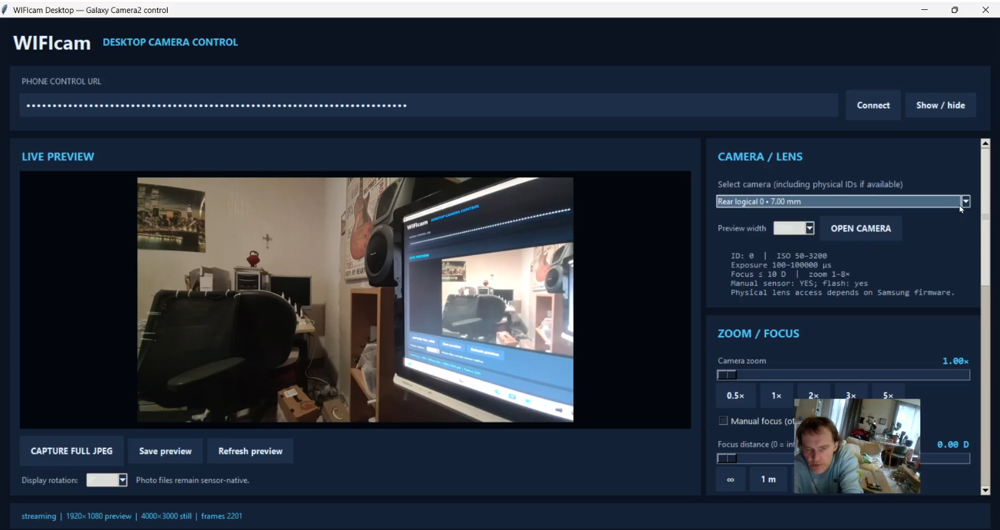
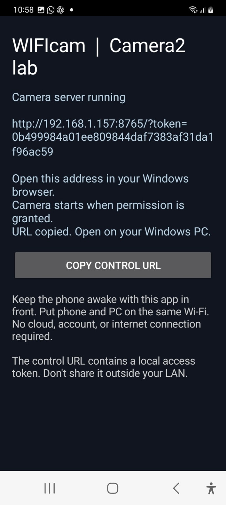

# WIFIcam



**Use an Android phone as a wireless camera, with full control from a Windows PC.**

WIFIcam is a lightweight Android app with a local Wi-Fi camera server. Watch the live preview, switch available cameras, adjust zoom, focus, ISO, shutter speed and white balance, and save photos from either the **WIFIcam Desktop GUI** or a web browser.

**No cloud, subscription, account or internet connection needed.** Your phone and PC just need to be on the same Wi-Fi network.

## Download and install

### 1. Install WIFIcam on your Android phone

**[⬇ Download WIFIcam APK for Android](https://raw.githubusercontent.com/anttiluode/WIFIcam/main/app-debug.apk)**

The APK is available in this repository as [`app-debug.apk`](app-debug.apk). Open the download link on your Android phone, then tap the APK to install. Android may ask you to allow installs from your browser or Files app. Grant Camera permission when WIFIcam starts.

> This is a **debug-signed APK for direct installation**, not a Play Store build. A successful [Android build](https://github.com/anttiluode/WIFIcam/actions/workflows/android.yml) automatically refreshes the APK in `main`. If a build is still running, you can also download the `WIFIcam-debug-apk` ZIP artifact from the latest successful workflow run and extract the APK. Debug builds from different runs may use different signing keys; if Android rejects an update, uninstall the previous debug build before installing the new one (uninstalling resets the saved token).

### 2. Control the camera from Windows

**[⬇ Download the Windows GUI files (repository ZIP)](https://github.com/anttiluode/WIFIcam/archive/refs/heads/main.zip)**

1. Extract the ZIP on your Windows 10/11 computer.
2. Double-click **`INSTALL_GUI.bat`** once to install the Pillow dependency. Python must already be installed on Windows.
3. Double-click **`LAUNCH_GUI.bat`** to start the **WIFIcam Desktop** control window.
4. Keep the WIFIcam app visible on your phone, with its screen awake, and connect the phone and PC to the same Wi-Fi.
5. On the phone tap **Copy control URL**. Paste the **complete URL**, including `?token=...`, into the desktop GUI and click **Connect**.

**No desktop installation required?** Paste that same URL into a Windows web browser to use the built-in camera controls. The browser interface is part of the Android app.

## What you can control

| Feature | WIFIcam Desktop / browser |
| --- | --- |
| Live picture | Wi-Fi preview (JPEG/MJPEG) |
| Camera selection | Available logical cameras and reported physical lenses, when supported |
| Zoom | Manual zoom and lens switching where Android Camera2 allows it |
| Focus | Autofocus or manual distance |
| Exposure | Automatic or manual ISO and shutter time |
| White balance | Modes and lock, depending on camera support |
| Light | Torch / LED on supported cameras |
| Photos | Full-resolution JPEG stills, preview saves, and desktop burst capture |
| Preview | Adjustable preview size / JPEG quality; desktop display rotation |

Available controls and usable lenses depend on the specific phone's Camera2 support. Some physical lenses are reported but cannot be opened directly; the app reports those limitations instead of claiming a successful switch.

## See it in action

**Android phone app**



**WIFIcam Desktop camera controls**


## How it works

The Android app starts a camera server on your phone, normally at port `8765`. It shows a local URL such as `http://192.168.1.157:8765/?token=YOUR_TOKEN`. Use **the URL on your own phone**; your IP address and token may differ. You can access that URL through the Windows GUI or a browser.

The app needs Android 9+ (API 28) and camera permission. Keep it in the foreground with the screen awake while using it. Camera images stay on your local network unless you choose to save or share them.

**Important security note:** The URL contains a private access token. WIFIcam uses unencrypted HTTP on your local network, so use a trusted Wi-Fi connection. Do not publish the URL, port-forward `8765`, or expose the camera server to the internet. The desktop GUI stores the URL at `%APPDATA%\WIFIcam\desktop.json`.

## Windows GUI details

Requirements: Windows 10/11, Python 3 with Tkinter, and Pillow (installed via `INSTALL_GUI.bat`). The desktop app is a Python GUI, **not** a prebuilt Windows `.exe`. Start it with `LAUNCH_GUI.bat` or run `python pc_gui.py`. For controls and setup notes, see [`GUI_README.txt`](GUI_README.txt).

## Advanced: command-line and HTTP control

An optional Python command-line client, [`pc_client.py`](pc_client.py), supports taking photos and setting camera controls from scripts. The URL always includes your phone's current token.

```powershell
$cam = 'http://PHONE_IP:8765/?token=PASTE_YOUR_TOKEN'
python pc_client.py $cam cameras
python pc_client.py $cam state
python pc_client.py $cam set --manual --iso 400 --shutter-us 10000 --manual-focus --focus 0
python pc_client.py $cam photo --output photo.jpg
```

Main endpoints: `GET /` (browser UI), `/api/cameras`, `/api/state`, `/stream`, `/snapshot`, `/photo`; `POST /api/camera` and `/api/set`. The server requires the `token` query parameter for all endpoints.

Manual focus `0` means infinity (not a nearby object); higher diopter values focus closer. A request being accepted does not guarantee a sensor physically applied every setting: supported ranges and firmware behavior differ.

## Build the Android app yourself

The Android source lives under `app/`. Build it with Android Studio or Gradle 8.9, Java 17, Android Gradle Plugin 8.7.3 and SDK 35. The GitHub [Build Android APK workflow](https://github.com/anttiluode/WIFIcam/actions/workflows/android.yml) builds a new debug APK when `main` changes, uploads the `WIFIcam-debug-apk` artifact, and updates the root `app-debug.apk` on a successful build. If a build fails or has not finished yet, the root APK remains the previous version.

MIT licensed. See [`LICENSE`](LICENSE).
